# Amaze — Manual

Amaze is an asset library in a Houdini pane tab. It holds materials,
colour palettes, node setups, code snippets and files on disk. Assets
are dragged straight onto viewport objects, networks and parameter
fields.

Installation is described in the [README](README.md).

- [First run](#first-run)
- [The panel at a glance](#the-panel-at-a-glance)
- [Material](#material)
- [Online materials](#online-materials)
- [Generate Material](#generate-material)
- [Color](#color)
- [Node](#node)
- [Code](#code)
- [File](#file)
- [Packages](#packages)
- [Add-ons](#add-ons)
- [Tile icons](#tile-icons)
- [Category colors](#category-colors)
- [Comments](#comments)
- [Drag and drop](#drag-and-drop)
- [Preferences](#preferences)
- [Housekeeping and troubleshooting](#housekeeping-and-troubleshooting)
- [Credits and licence](#credits-and-licence)

---

## First run
<!-- {#m/first-run} -->

**New Pane Tab Type ▸ Amaze**, on the **+** menu at the right of a pane
tab strip, adds the Amaze panel.

**Shelves ▸ Amaze**, on the **+** menu at the right of the shelf tab
strip, adds the Amaze shelf. Houdini stores shelf tabs per machine and
per Houdini build, so the shelf is added again after an upgrade.

**Preferences ▸ Library ▸ Add** picks the library folder, where saved
assets are kept: an existing library, or an empty folder for a new one.
Pick your user or create one, then press **Apply**. The library belongs
outside the plugin folder, which updates replace. Cloud-synced folders
are supported.

The library holds a list of the assets in JSON and one Houdini node
archive per asset (`.mat` and `.interface`). Both are standard Houdini
files.

The **Amaze shelf** has five tools:

| tool | function |
|---|---|
| **Amaze** | Opens the panel. |
| **Capture** | Captures the Scene View as the open scene's picture. |
| **Repair** | Repairs a damaged library. See [Housekeeping](#housekeeping-and-troubleshooting). |
| **Updates** | Checks for a newer Amaze and installs it after confirmation. |
| **Reload** | Installs new asset files from the packages on the Houdini path and reloads all loaded asset definitions without a restart. |

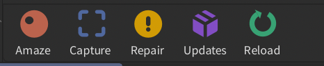

---

## The panel at a glance

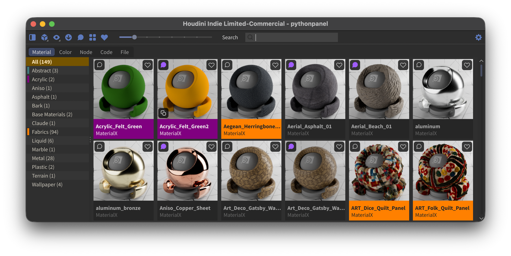

The **section tabs** at the top switch between Material, Color, Node,
Code and File. Each section keeps its own category, view mode and scroll
position. Preferences ▸ Show/Hide ▸ Sections sets which sections are
shown.

The **toolbar**, from left to right:

| | | |
|:--:|---|---|
|  | **Show Categories** | Shows and hides the sidebar. |
|  | **Import/Generate** | Gallery Import (.gal), Package Import (.amazepkg) and Generate Material. |
|  | **Filter** | Filters the grid: Material by renderer, Color by the number of colors, Node by network type, Code by language and File by kind. |
|  | **Online** | Switches between the library and the online sources. |
|  | **Comments** | Opens and closes the [Comments pane](#comments). Purple while the pane is open. |
|   | **Grid / List** | Switches between grid view and list view. |
|  | **Favorites** | Shows favorites only. |
|  | **Size slider** | Sets the thumbnail size, 64–512 px, and the row height in list view. |
|  | **Search** | Searches names and tags in the current section. A leading colon searches tags only: `:metal` finds everything tagged metal. |
|  | **Capture** | Captures the Scene View as the selected tile's picture. In the File section with no tile selected, captures it as the open scene's picture. |
|  | **Preferences** | Opens [Preferences](#preferences). |

The **Import/Generate** and **Filter** menus:

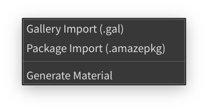
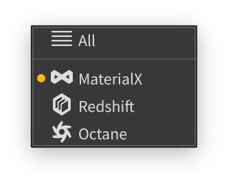

The Filter menu in Color, Node, Code and File:

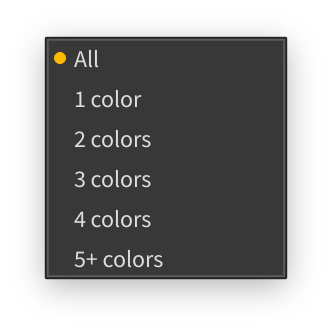
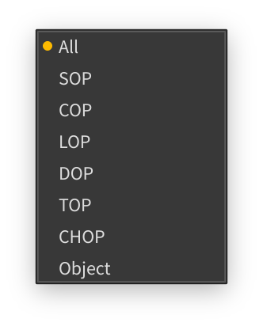
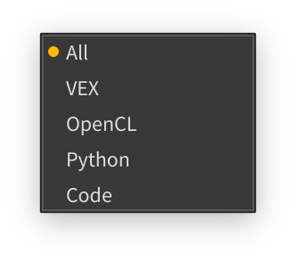
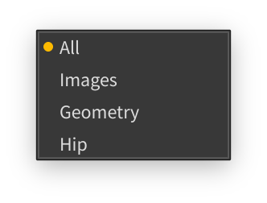

**Favorites** shows only the assets marked as favorites.

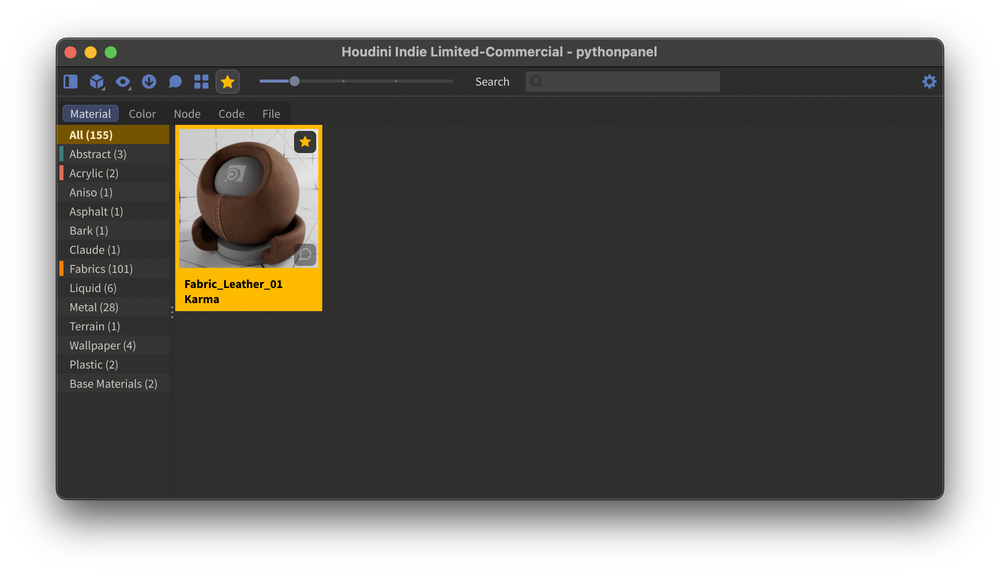

**List view** shows the assets as rows.

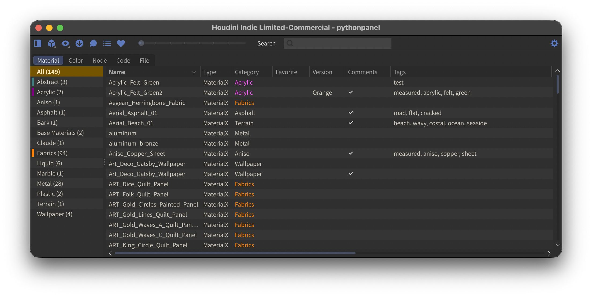

**Name** and **Type** are always shown. **Category**, **Favorite**,
**Version**, **Open**, **Comments**, **Tags**, **License**, **Date** and
**ID** are shown where the section has them. Favorite, Open and Comments
are shown as ticks, and Category takes the
[category colour](#category-colors). Clicking a column heading sorts by
that column, and dragging the edge of a heading sets its width.

The **sidebar** holds categories (Material, Node, Code), registered
folders (File) or palette groups (Color). Its right-click menu adds,
renames, deletes and [colours](#category-colors) categories; File's
folders have a menu of [their own](#locations). **Sort by name** sorts
the categories alphabetically, with All at the top. Preferences ▸ Look
sets the category counts and hides empty categories.

Sidebar rows are reordered by dragging. A press of about half a second
picks a row up, releasing it sets the new order, and Esc cancels the
move. **All** stays at the top, and new categories are added at the
bottom. Category order is stored in the library; folder order is stored
per machine.

The sidebar and the Comments pane keep their width between sessions.

A tile has up to four **badges**, one per corner:

| | | |
|:--:|---|---|
|  | top-left | Comments: filled when the asset has [comments](#comments). Opens and closes the Comments pane. |
|  | top-right | Favorite: an outline heart, filled pink on a favorite. A click toggles it; on a selected tile, it toggles every selected tile. |
|  | lower-left | [Versions](#versions). Opens the version list. |
|  | lower-right | The renderer a material is for: MaterialX, Redshift or Octane (Material). |
|  | lower-right | The scene that is open in Houdini (File). |
|  | lower-right | Opens the snippet in the code editor (Code). |

---

## Material

Stores material networks with a rendered preview. Supported renderers
are Redshift, Karma (MaterialX) and Octane.

### Saving

**Save to Amaze**, on the right-click menu of a material node in the
network editor, opens the save dialog. The dialog sets the name,
category and tags, and **Section** sets the section the material is
saved to. Amaze renders a preview and adds the material to the library.

A material that is already in the library is saved as a new version or
as a new material.

Previews use the display and view transform of the Scene Viewer and
require `$OCIO`.

### Preview rendering

Karma and Octane previews render in the background. A progress bar
above the grid follows the render, and each tile updates when its
preview is done. Redshift previews render in the foreground.

**Update Render** renders the selected materials again. **Cancel**, at
the right end of the tab row, stops the render.

### Versions

Saving over a material keeps the previous one as a version. A tile with
versions shows the

badge in its lower-left corner. The badge opens the list of versions,
newest first; pick one and press **Select** to make it current.

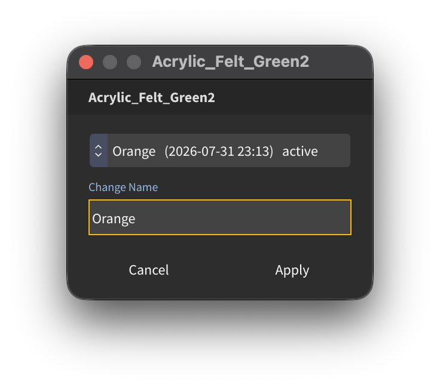

A snippet keeps versions too. In the code editor, each version opens in
a tab of its own above the fields. The **+** after the tabs lists **New
Version** and the snippet's versions: a version opens in a new tab, or
its tab comes to the front, and **New Version** opens a tab with the
front tab's code. **Apply** saves the code in the front tab, which
becomes the snippet's current version. A tab's × closes it; the version
is still in the **+** list. The Name field names the version, and the
snippet's tile shows the name of its current version.

**Versions** in Preferences ▸ Library turns versions on and off, for
materials and snippets.

### Loading

- **Double-click** loads the material into the current network.
- **Copy To ▸ /mat** and **Copy To ▸ /stage/materiallibrary** load it
  into that location.
- **Dragging** the tile onto an object assigns the material; dragging it
  into a network loads it there. See [Drag and drop](#drag-and-drop).

### Tile menu

**Copy To**, **Convert to**, **Update Render**, **Capture**,
**Customize**, **Favorite**, **Export Package** and **Delete**.

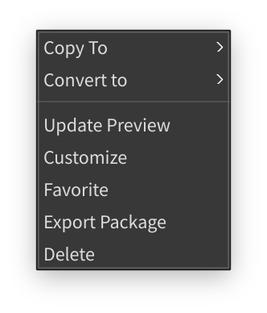
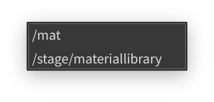
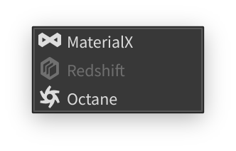

[Customize](#tile-icons) sets the name, category and tags. Dragging a
tile onto a category in the sidebar moves it to that category.

### Converting

**Convert to ▸ MaterialX**, **Redshift** or **Octane** builds a copy of
the material for that renderer next to the original, with the same name
and textures. Anything that cannot be converted is listed in a report.

All conversions go through MaterialX. Redshift to Octane, for example,
converts Redshift to MaterialX and then MaterialX to Octane. Octane
materials are built in Octane's own material builder.

---

## Online materials

The 
**Online** button switches the panel to the online material sources,
shown as tabs in place of the section tabs. A second press returns to
the library. A thin bar above the grid fills while the sources are
listed and again while their pictures load.

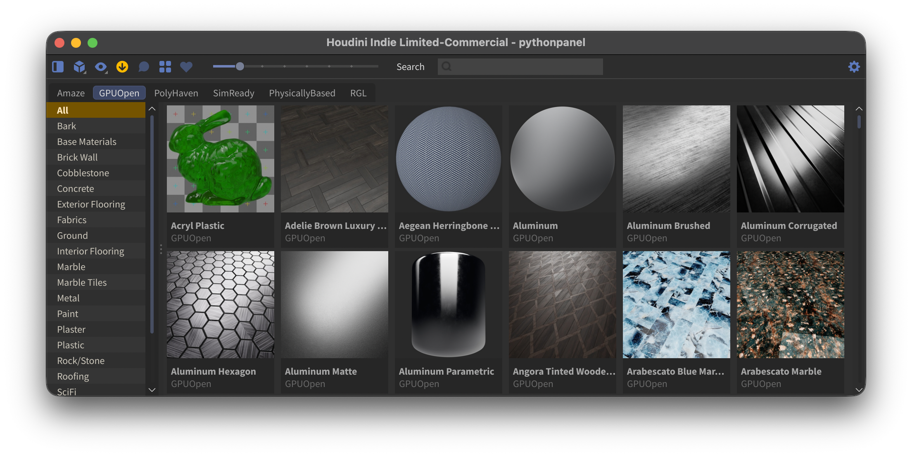

| Source | Content | Licence |
|---|---|---|
| **PolyHaven** | Photoscanned PBR materials with textures | CC0 |
| **GPUOpen** | AMD's MaterialX library with textures | MIT Public Domain |
| **SimReady** | NVIDIA's OpenPBR materials with textures | MIT-0 |
| **PhysicallyBased** | 86 measured reference materials, such as copper, water and skin | CC0 1.0 |
| **RGL (EPFL)** | 62 laboratory-measured materials from the Realistic Graphics Lab | CC0 1.0 |
| **Amaze** | The official [packages](#packages), for import or restore | per package |

The right-click menu acts on one material or a selection:

- **Import to Materials ▸ MaterialX**, **Redshift** or **Octane**
  downloads the material, builds it for that renderer and saves it to
  the library, with a preview when renders are on. A MaterialX import
  from SimReady, PhysicallyBased, RGL, PolyHaven or GPUOpen keeps the
  tile's picture as its preview instead. A renderer is available when its
  plugin is loaded.
- **Import to Scene ▸ MaterialX**, **Redshift** or **Octane** builds the
  material in the current material library, or in `/mat`.
- **Restore**, on Amaze packages, restores the entries the package
  carries.
- **Refresh** reloads the source.

**Double-click** imports a material into the scene.

Every import records its source, author, link and licence.

### Gallery Import (.gal)

**Import/Generate ▸ Gallery Import (.gal)** reads a Houdini gallery
file, including the Material Palette's own, and adds every material
preset in it to the library. **Update Render** renders their previews.

---

## Generate Material

**Import/Generate ▸ Generate Material** builds a test material in the
current material library.

Generation starts from one of 148 measured materials, 86 PhysicallyBased
reference values and 62 RGL measurements, and varies it within its
physical class:

- **Metals** keep their measured reflectance. The colour drifts by a few
  percent or blends toward another measured metal, and the finish comes
  from a measured metal surface.
- **Glass and liquids** keep their measured IOR.
- **Skin, marble and milk** keep their measured scattering distance.
- **Opaque dielectrics** take a free hue, with roughness from the
  measurement.

Clearcoat, sheen and emission follow the rates of a set of 287 authored
materials: about a third have a clearcoat, and very few emit.

The **node comment** of a generated material records the measurement it
started from and what was varied. Generated materials are scene nodes,
added to the library with **Save to Amaze**.

---

## Color

Stores colour palettes. A new library includes palettes from Sanzo
Wada's *A Dictionary of Color Combinations*, Paul Klee, Josef Albers and
Johannes Itten.

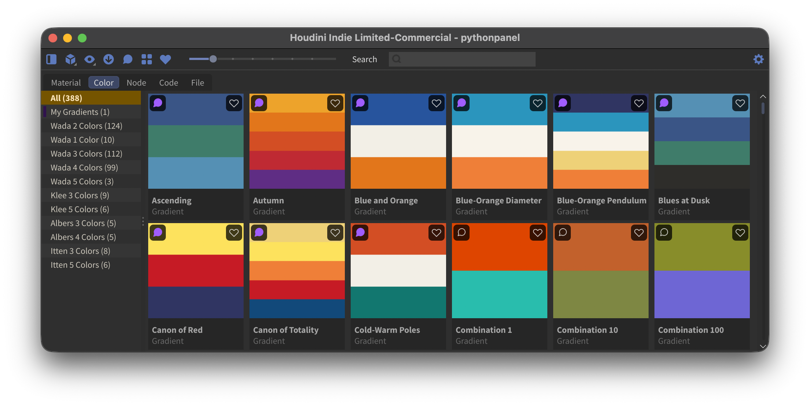

The right-click menu:

- **Apply** applies the palette to the selected node's ramp parameter. On
  a node with no ramp parameter, it creates a ramp node, as a
  double-click on the tile does.
- **Apply as ▸** applies the palette with an interpolation: Constant,
  Linear, CatmullRom, MonotoneCubic, Bezier, BSpline or Hermite.
- **Copy Color ▸** lists the swatches by name and hex code, and copies
  the chosen hex code to the clipboard.
- **Capture**, **Customize**, **Favorite**, **Export Package** and
  **Delete**.

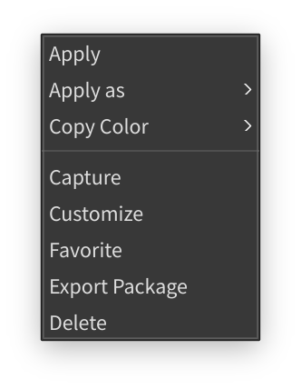
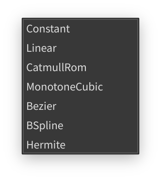
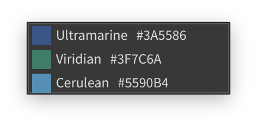

**Save to Amaze** on a node with a colour ramp, with **Section** set to
Color, saves the ramp as a palette.

---

## Node

Stores node setups: a whole network, a selection or a single node.
Supported contexts are SOP, Copernicus, LOP, DOP, TOP, CHOP, object level
and material networks. Each asset records its context, shown on its
tile.

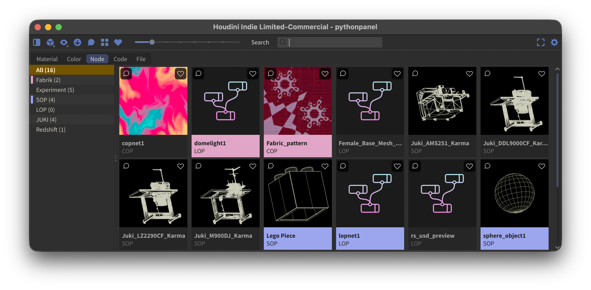

**Save to Amaze**, with **Section** set to Node, saves the contents of a
network container (a `geo`, `copnet`, `lopnet` or `subnet`) or the
selected nodes.

**Double-click**, a drag, or **Load** on the right-click menu loads the
nodes into the network under the pointer, or into a new container of
the right type.

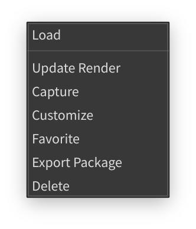

Assets load only into networks of their own context.

Previews follow the context: a Copernicus asset shows its output image,
a SOP asset shows its geometry, and other contexts show the node icon.

---

## Code

A snippet library for VEX, OpenCL and Python, with syntax-highlighted
previews on the tiles. A new library includes a set of **examples**.

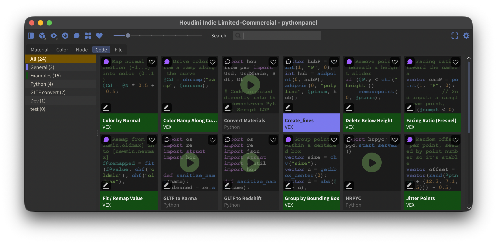

The right-click menu:

- **New File** opens the editor on a new snippet.
- **Apply** writes the snippet into the selected node's code parameter.
- **Edit** opens the snippet in the editor, with Name, Language,
  Category and Tags above the code. In the editor, **Apply** saves the
  snippet and the editor stays open. The tabs above the fields hold the
  snippet's [versions](#versions).
- **Capture**, **Customize**, **Favorite**, **Export Package** and
  **Delete**.

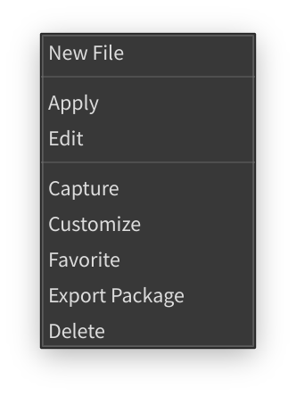
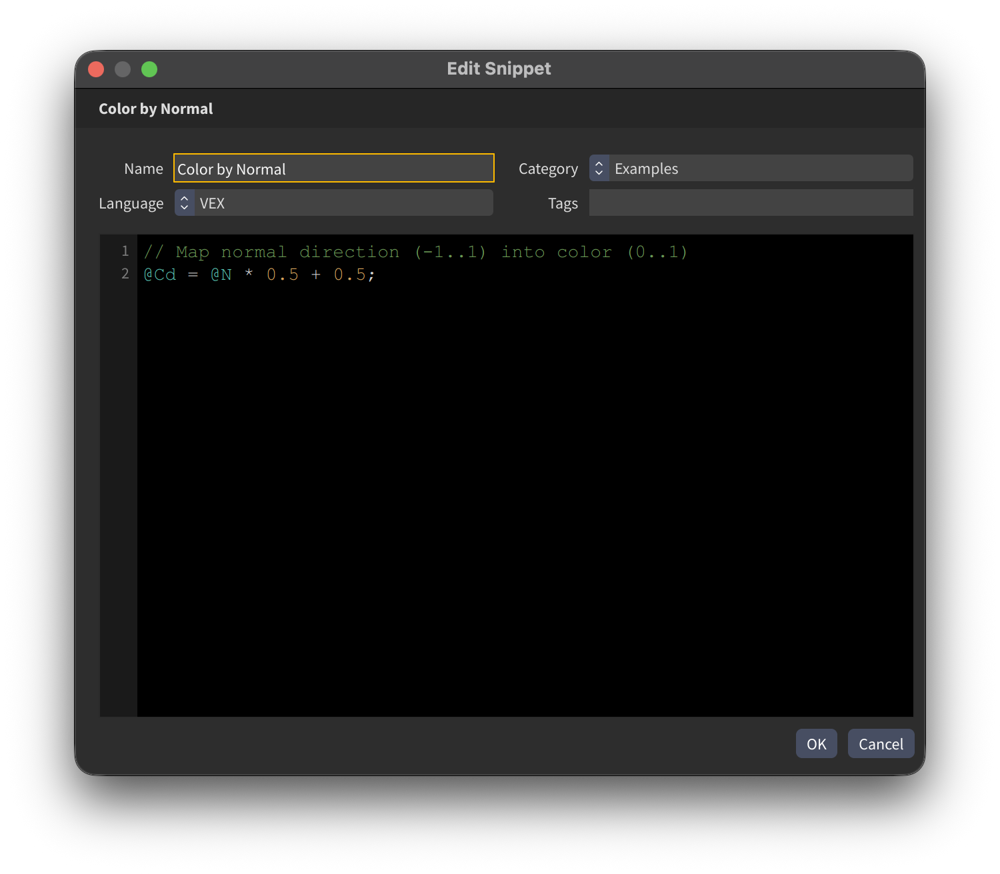

**Double-click**, or a drag onto a node, applies the snippet. **Save to
Amaze** on a node with a code parameter saves its code as a snippet;
**Language** is read from the node and can be changed.

A Python snippet's tile has a green run button. It runs the snippet with
the same `kwargs` a shelf tool receives, as one step in **Edit ▸ Undo**.
Errors show in Houdini's status bar with the snippet's name. The pencil
in the lower-right corner of a snippet's tile opens the editor.

---

## File

Browses folders on disk.

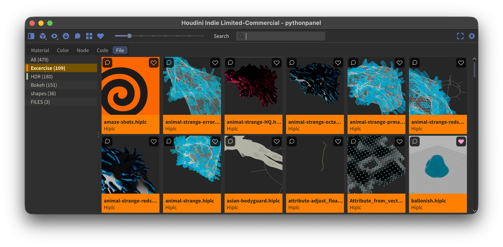

- **Images** (PNG, JPG, EXR, HDR, TGA, RAT and more) get cached
  thumbnails. **Double-click** or **Load to Node** sets the file on the
  selected node's image parameter, and a drag sets it on any parameter
  field. Formats Qt cannot read are converted in the background, and
  Preferences ▸ Render sets how many convert at once. **Cancel**, at the
  right end of the tab row, stops the conversion and keeps the
  thumbnails already made.
- **Geometry** (.bgeo, .obj, .fbx, .abc, .usd and more) gets
  viewport-rendered thumbnails, wireframe over shaded. **Double-click**,
  or a drag into a network, imports it in context and keeps the current
  node and display flag. Esc interrupts a long first scan, which
  resumes later.
- **Scenes** (.hip, .hiplc, .hipnc) open on **double-click**, with
  Houdini's own prompt for unsaved changes. A scene dragged out of the
  panel and released also opens. The open scene has a tick on its tile.
  A scene's picture is a capture: **Capture** on the right-click menu, or
  the 
  **Capture** button, takes one from the Scene View while that scene is
  open.
- **Other files** show their system icon. **Copy Path** copies the path
  to the clipboard, written as set in [Write Paths As](#write-paths-as).
  A location lists these files when **Show ▸ Other Files** is on.

The right-click menu: **Load**, **Copy Path**, **Show Location**,
**Capture**, **Customize**, **Favorite** and **Export Package**.

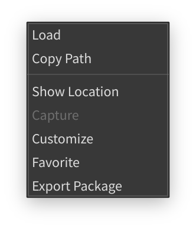

### Locations

The sidebar's right-click menu:

- **Add** registers a folder.
- **Locate** points a registered folder at its new place on disk and
  keeps its favorites, name and settings.
- **Rename ▸ Edit** sets a display name. **Set to Default** restores the
  folder's own name.
- **Remove** unregisters the folder and clears its name, colour, Show
  settings, favorites, comments, tile icons and cached thumbnails.
  Captures are kept.
- **Show ▸** sets what the location lists:
  - **Pathname** shows the full path as the name, written as set in
    **Write Paths As**.
  - **Subfolder** includes the folders inside it.
  - **Other Files**, **Images**, **Geometry** and **HIP** set the kinds
    of file listed. **Other Files** covers everything except images,
    geometry and scenes.
- **Label ▸** colours the location, as on a
  [category](#category-colors).

A new location lists Images, Geometry and HIP, without subfolders.

A removed folder is removed for everyone who uses the library. An Amaze
that is running on another computer shows the removal after a restart.

### Write Paths As

Preferences ▸ Look ▸ **Write Paths As** sets how Copy Path and **Show ▸
Pathname** write paths: **$HOME** (the default), **$JOB**, **$HIP** or
**Absolute**. A variable is used when the path is under it; other paths
are written in full.

---

## Packages

A **package** is a single `.amazepkg` file that carries assets with their
files, previews, categories, tags and comments. Packages move assets
between machines, libraries and people.

**Export Package**, on the right-click menu of every section, writes the
selected assets to a package. **Export Category**, on the sidebar's
right-click menu, writes a whole category.

**Import/Generate ▸ Package Import (.amazepkg)** adds a package to the
library. Imported assets get new identities and are filed under the
**Import** category, so a package imported twice gives two copies. The
package's files go into an **Import** folder in the library, which the
File sidebar lists as a location with every kind of file shown.

**Restore**, on the right-click menu of a package in the **Amaze** source
of the [online browser](#online-materials), puts its entries back under
their original identities and replaces the existing ones. It restores
default palettes and materials.

---

## Add-ons

An **add-on** is a set of Houdini nodes that Amaze installs from the
Amaze store and keeps up to date, such as Shapes. Each add-on is
installed in its own folder inside Amaze's.

**Preferences ▸ Add-On** lists the nodes of the installed add-ons, each
row with a picture, the version and author, a switch and a short
description. Nodes that belong together share a row and a switch.

The switch takes effect at the next start of Houdini, and the line next
to the button says so after each change. Switched off, the row's nodes
are left out when Houdini starts; scenes that use them keep their values
and show the nodes as incomplete until they are switched on again.

**Check for Updates** lists new add-ons and newer versions from the store
in the line next to it, and turns into **Update**, which installs them.
They load at the next start of Houdini. Rows that are off stay off.

**Preferences ▸ About ▸ Add-On beta versions** sets which version Check
for Updates installs: the newest beta of each add-on when on, the newest
release when off.

Houdini loads add-ons through the `package_path` line in `Amaze.json`,
described in the [README](README.md)'s installation steps.

---

## Tile icons

**Customize**, on every tile's right-click menu, opens the Customize
dialog.

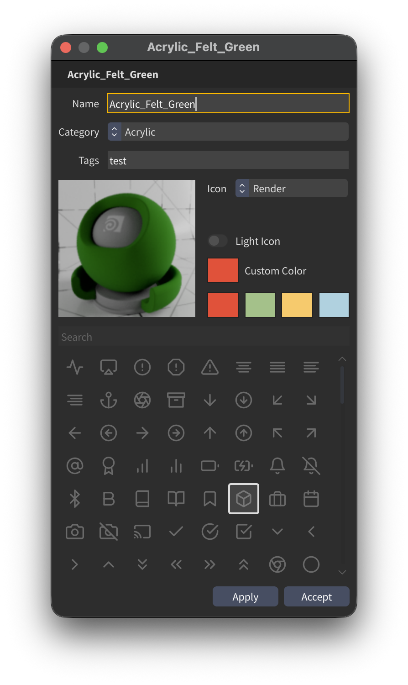

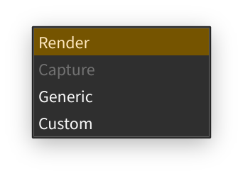

The **Image** menu sets what the tile shows:

- **Render**: the tile's own picture. That is a material's or a node
  network's render, a snippet's code, a palette's swatches or a file's
  preview.
- **Capture**: a picture of the Scene View, taken with **Capture** on the
  tile's right-click menu or the toolbar. Greyed for a tile without one.
- **Generic**: the section's icon.
- **Custom**: one of 287 Feather icons on a background colour, from four
  presets or any colour through the chip next to **Custom Color**.
  **Light Icons** draws the symbol light.

Render is the default where Amaze makes a picture, and a tile shows its
Generic icon until its picture exists. Scenes default to Capture. Node
networks outside SOP and COP default to Generic, with Render greyed.
Other files default to Render, which is the system icon for the file
type. Taking a capture switches the tile to Capture. The preview square
shows the finished tile.

Captures are stored in the library's `captures` folder, so every computer
using the library shows them.

The dialog also sets the asset's **Name**, **Category** and **Tags**. On
a multi-selection, Category moves every selected tile and Tags adds to
each tile's tags. **Apply** saves and keeps the dialog open; **Accept**
saves and closes it.

- Changes apply to the whole selection.
- A custom icon is stored next to the render, a capture in the
  `captures` folder, and **Render** brings the render back.
- Tile icons are stored in the library.

Preferences ▸ Look ▸ **Tile Icon Line** sets the line weight.

---

## Category colors

**Label**, on a category's right-click menu in the sidebar, colours the
category **Red**, **Yellow**, **Blue** or **Green**, or any colour
through **Custom**. Every tile in the category shows the colour in the
strip under its thumbnail, and the category's sidebar row gets a
matching bar on its left edge. In [list view](#the-panel-at-a-glance),
the Category column takes the colour. **Label ▸ Remove** removes it.

The name and type text switches between dark and light to stay
readable. A renamed category keeps its colour; a deleted category takes
its colour with it.

An asset has one category. Tags place an asset in several groups at
once.

**Export Category**, on the same menu, writes the whole category to a
[package](#packages).

---

## Comments

The 
**Comments** button in the toolbar, between Online and Grid/List, opens
and closes the **Comments pane**, a page per asset docked next to the
grid. The button is purple while the pane is open.

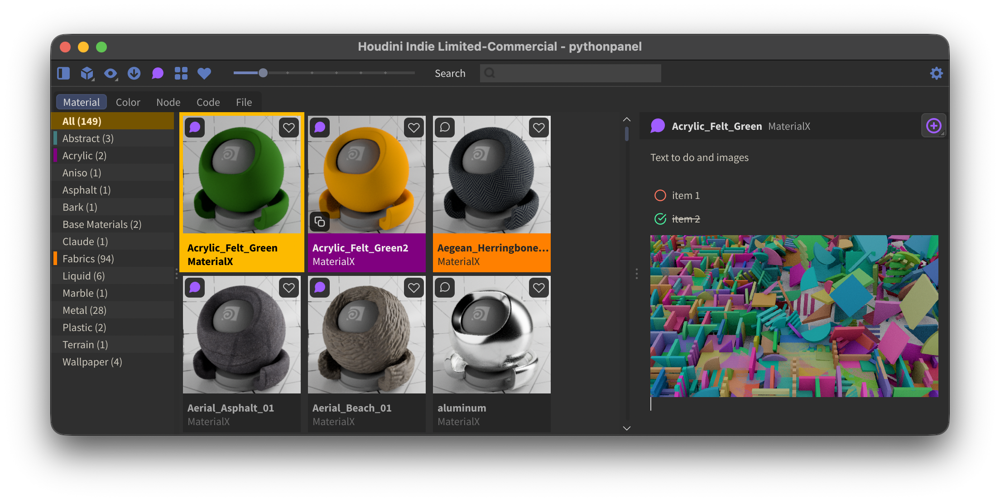

The page is one document per asset. The **+** button inserts at the
cursor:

- **Bullet point**: a framed line for a to-do.
- **Image**: a picture, copied into the library and scaled to the width
  of the pane.

In a to-do, Enter adds another to-do, and Enter on an empty to-do
returns to plain text. A click on a to-do's marker checks it off. A
to-do with no text is removed. Changes are saved as they are typed.

Backspace at the start of a to-do turns it into plain text. Deleting
across the line above or below a to-do joins the lines, and the to-do
keeps its marker.

Comments are stored in the library and shared across machines. The
 badge in
the top-left corner of every tile is filled when the asset has
comments, and a click on it opens and closes the pane.

Every section takes comments: materials, palettes, nodes, snippets and
files.

---

## Drag and drop

Dragging works the same way in every section and onto every
destination.

**Materials**

- Onto an **OBJ viewport** object: assigns the material.
- Onto a **Solaris (LOP) viewport** object: opens a menu.
  - **Swap ‹material›** replaces a material already bound to that prim,
    and removes the old one from the library node when nothing else
    uses it.
  - **Set as Material on ‹prim›** binds the material to that prim or to
    one of its parents.
- Onto a **materiallibrary LOP** in the network editor: imports the
  material into it, wired and registered.
- Onto the **network editor**: imports the material there.

During a drag over a viewport, the prim under the pointer is highlighted
with Houdini's scene graph highlight. A drop on an invalid target shows
a miss indicator
.

**Other assets**

- **Images and other files** onto a parameter field: set the file, as a
  file from the OS file browser does.
- **Geometry** into a network or viewport: imports it in context at the
  drop point.
- **Scenes** released outside the panel: opens the scene, as a
  double-click does.
- **Code** onto a node: writes the snippet into the node's code
  parameter.
- **Any asset** onto a sidebar category: files it in that category.

---

## Preferences

The 
gear button opens Preferences, a floating window that stays open next to
the scene. It has six tabs.

### Library

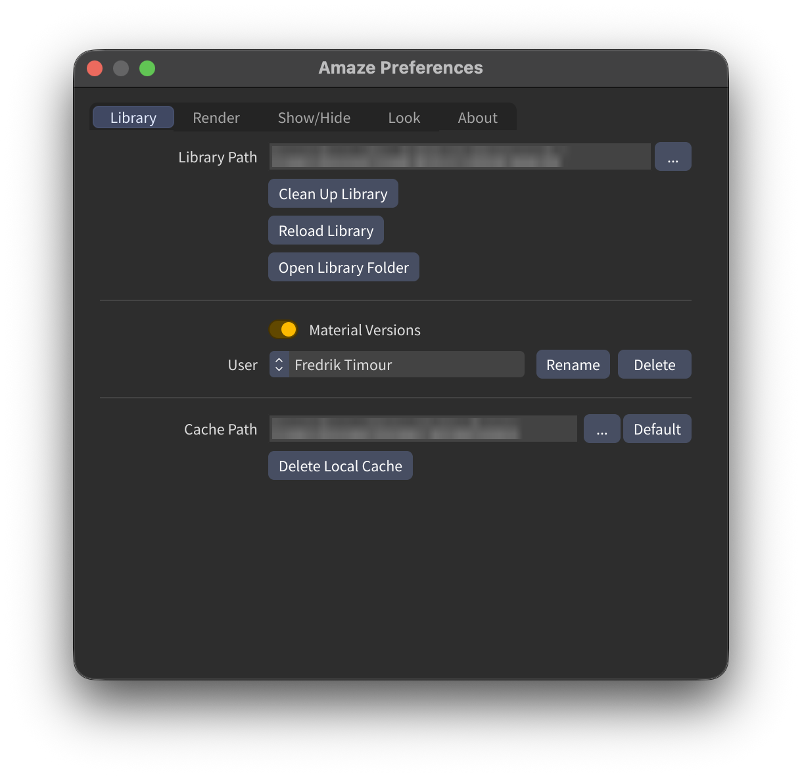

**Library** lists the libraries this computer has opened, the most
recent first. Picking one shows its users and its format; **Apply**
opens it with the user picked, and **Accept** does the same and closes
Preferences. Until then the open library stays open. **Add** puts a
library folder in the list, or an empty folder for a new library. The
list holds 20 libraries; **Manage** takes libraries off it. **Clean
Up**, **Reload** and **Show Folder** act on the open library.

**Format** is the library's version. Version 2 keeps scene captures in
the library. For a library from an older Amaze, the line beside
**Apply** says that applying updates it; Amaze then moves this
computer's scene captures into the library's `captures` folder, and the
originals stay in Amaze's holding folder for 30 days. A library from a
newer Amaze cannot be applied, and the line says to update Amaze.

**Versions** turns [versions](#versions) on and off, for materials and
snippets.

**User** lists the users in the picked library. Favorites, File folders
and saved versions belong to the user, so the same user on another
computer sees the same items. Amaze picks the user with the same name as
the current one, or the library's only user; otherwise pick one, or
**Create a new user...**. Two users in one library cannot share a name.
**Rename** renames the user shown, and **Delete** removes them with
their favorites and registered folders on every computer that uses the
library, after a confirmation. Amaze opens a library only with a user
picked: when it starts without one, it shows a message with **Open
Preferences**, which opens this tab. A computer still signed in as a
deleted user shows the same message the next time Amaze opens.

**Cache Path** and **Delete Local Cache** manage the thumbnail cache on
this machine.

### Render

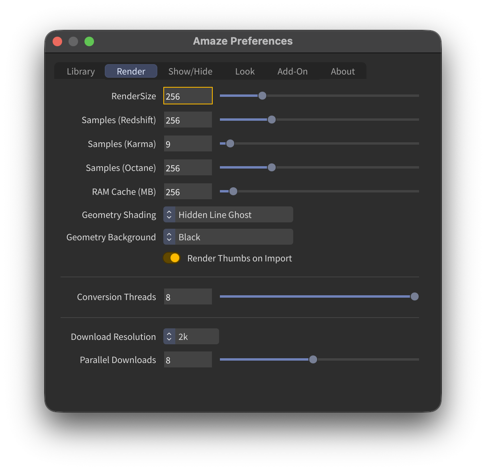

**RenderSize**, **Samples (Redshift)**, **Samples (Karma)**, **Samples
(Octane)**, **RAM Cache (MB)**, **Geometry Shading**, **Geometry
Background** and **Render Thumbs on Import**. Below the divider:
**Conversion Threads** for texture conversion, and **Download
Resolution** and **Parallel Downloads** for the online sources.

### Show/Hide

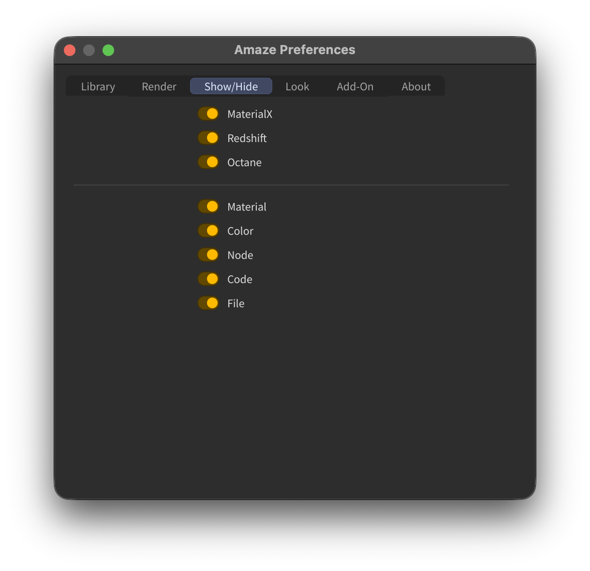
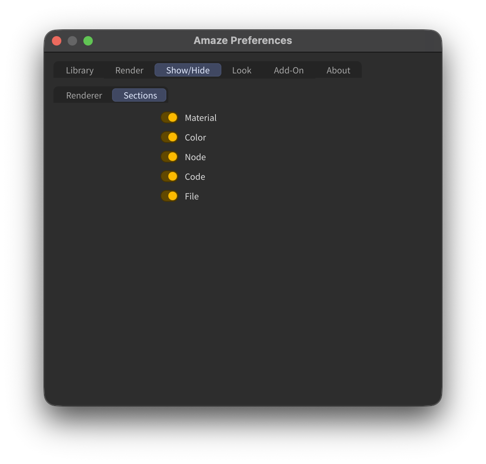

Two sub-tabs set which renderers and sections Amaze shows.

- **Renderer** has a switch for each renderer. A renderer that is
  switched off is removed from the [Filter](#the-panel-at-a-glance)
  menu, Convert to, Import to Materials and Import to Scene, and its
  Samples row is removed from the Render tab.
- **Sections** has a switch for each section. A section that is
  switched off has no tab in the panel.

### Look

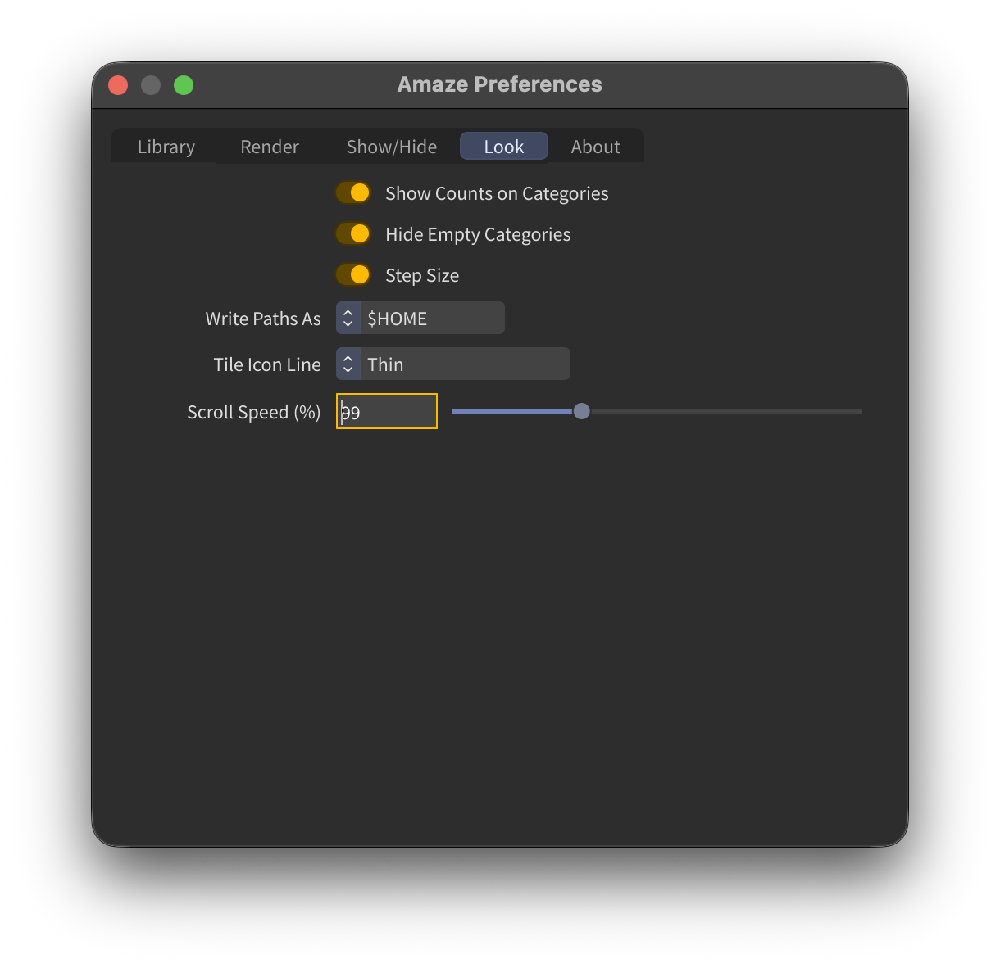

**Show Counts on Categories**, **Hide Empty Categories**, **Step Size**
(the size slider moves in steps of 64 px), **Write Paths As**, **Tile
Icon Line** (Thin, or Feather's Regular) and **Scroll Speed (%)**.

### Add-On

The installed add-ons, a switch for each row, and **Check for Updates**
for the Amaze store. See [Add-ons](#add-ons).

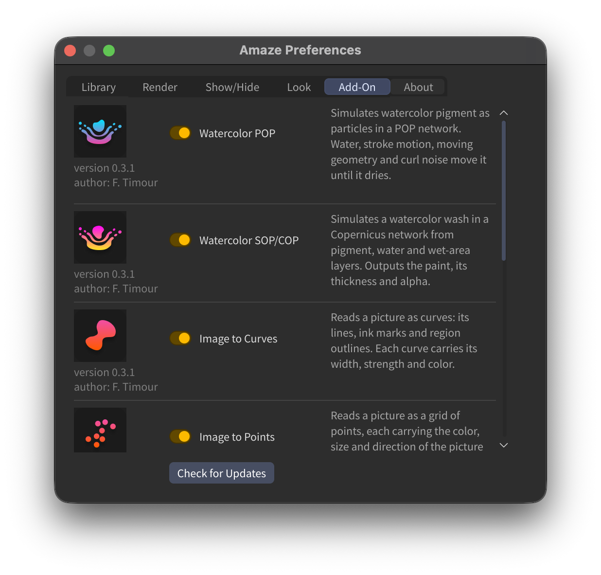

### About

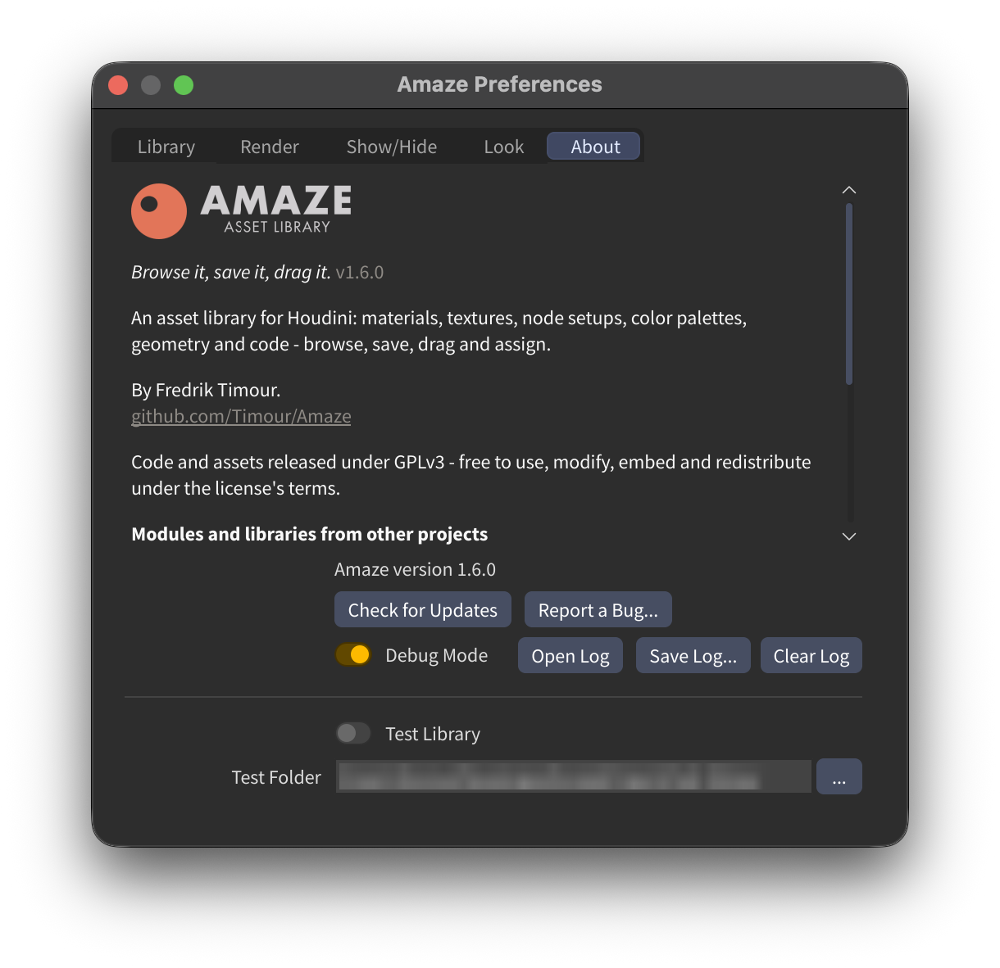

Credits and licences. The version line shows the running version and
the answer to each update check. **Check for Updates** checks for a
newer Amaze; when there is one, the button changes to **Install
Update**, which installs it. When the newer Amaze also updates the
library, **Install Update** is red, the version line names the library
version it updates to, and installing asks to **Continue** or
**Cancel** first. The **Updates** tool on the shelf asks the same.
**Report a Bug...** opens the Amaze bug page
in the browser with the Amaze, Houdini and OS versions filled in; the
report is sent with **Submit** on that page.

**Debug Mode**, **Open Log**, **Save Log...** and **Clear Log** control
the debug log. **Test Library** switches Amaze to a test library in the
folder next to it, with the user of the same name, which it creates
there when the test library has none; switched off, Amaze returns to the
library picked on the Library tab, its Cache Path and registered
folders. **Add-On beta versions** sets which
version of each add-on Check for Updates on the Add-On tab installs: the
newest beta when on, the newest release when off.

> **Where settings are stored.** Render settings, renderer choices,
> conversion and download settings, and Write Paths As are stored in the
> library and shared by everyone who opens it. Settings for this machine,
> such as view mode, icon sizes, panel widths and visible tabs, are
> stored in the OS preferences folder (`~/Library/Preferences/Amaze` on
> macOS, `%APPDATA%\Amaze` on Windows, `$XDG_CONFIG_HOME/Amaze` on
> Linux), which updates and reinstalls leave in place. When the library
> is unreachable, Amaze uses the last values it read.

---

## Housekeeping and troubleshooting

**Clean Up** (Preferences ▸ Library) scans the library in one
pass for entries with missing files, uncategorized assets, category
names to normalise, registered folders that no longer exist and
favorites that point at missing files, and reports the result in one
summary.

Entries with missing files are reported and kept, since a file that is
still syncing looks the same as a deleted one; **Delete** removes them.
Files that no asset list uses are moved to Amaze's holding folder on
this computer, outside the library, named in the summary and kept for
30 days. Folders on drives that are not mounted are skipped.

**Repair**, on the Amaze shelf, repairs a library when Clean Up refuses
or the panel does not open. It reads the library, reports the
problems and offers two fixes: rebuilding the asset list from the
recovery copy stored with each asset, or restoring a snapshot. When
`settings.json`, the settings file that names the library, is unreadable
or missing, Repair lists its dated copies and restores one. Its
strongest action moves files into a dated folder inside the library.

Every write takes a snapshot of the asset list first, with rolling
backups and a first-run copy, and writes from a second Houdini session
are merged.

**Versions** (Preferences ▸ Library) is stored in the library,
and every computer that uses the library shares it.

**Debug Mode** (Preferences ▸ About) records a session log. **Save
Log...** writes a copy to attach to a bug report.

**A material renders black.** The usual causes are a texture that failed
to download, or a material library node whose material list no longer
includes the material. The log names both.

**A changed Python file** loads after a restart of Houdini, which caches
modules per session.

---

## Credits and licence

Amaze uses code from [egMatLib](https://github.com/eglaubauf/egMatLib)
for its material preview engine. Thank you.

Colour palette sources: Sanzo Wada (public domain, via
dblodorn/sanzo-wada), Paul Klee, Josef Albers and Johannes Itten
(interpretive palettes from public-domain works).

Tile icons are [Feather](https://feathericons.com) by Cole Bemis (MIT).

Online material sources: [Poly Haven](https://polyhaven.com/) (CC0),
[AMD GPUOpen](https://matlib.gpuopen.com/) (MIT Public Domain),
[NVIDIA PhysicalAI-SimReady-Materials](https://github.com/NVIDIA-Omniverse/PhysicalAI-SimReady-Materials) (MIT-0),
[Physically Based](https://physicallybased.info/) by Anton Palmqvist
(CC0 1.0) and [EPFL RGL](https://rgl.epfl.ch/materials) measured
materials (CC0 1.0).

Amaze is **GPLv3**. See [LICENSE](LICENSE).
